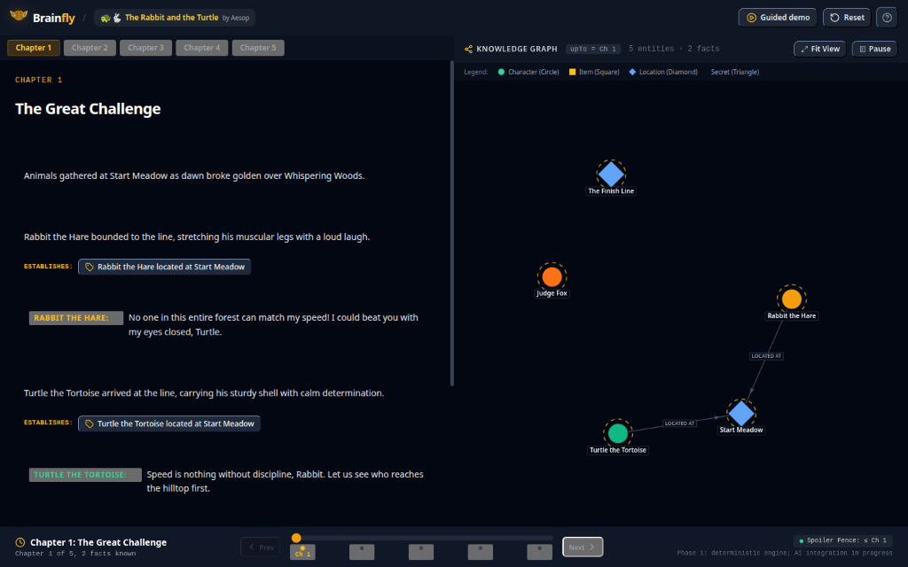
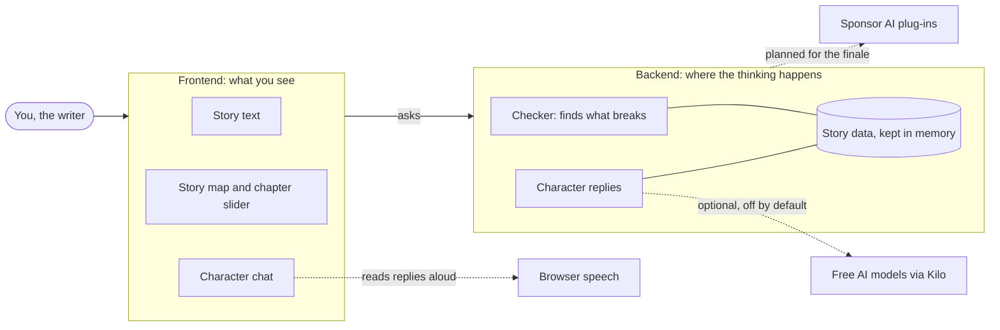

<p align="center">
  
</p>

<p align="center">
  
  
  
  
  
  
</p>

**Brainfly helps writers catch story mistakes before readers do.**

Say you write that the Rabbit finds the apples in Chapter 2. Later you change your mind and let the Turtle find them. Now every scene that mentions the Rabbit's apples is wrong. Brainfly shows you all of those scenes at once, and tells you why each one broke.

**No guessing:** the check is plain logic, not AI, so it never makes things up.

**Team Init Duo** · GeNarrative Clash 2026 · Track 01: Storytelling & Narrative Co-Writers  
**Demo video:** [watch it here](https://links.anujkp.dev/brainfly)



## What you can do

- **Change something, see what breaks.** Edit a story fact and Brainfly lists every later scene it affects, before you save. Each one has a short "Why?" explanation.
- **Scrub through the story.** A slider moves from Chapter 1 to 5. The map of characters, places and things only shows what the reader knows by then.
- **Chat with a character, no spoilers.** Ask the Turtle about the golden trophy in Chapter 2 and he says he doesn't know about it yet. Move to Chapter 4 and he does.
- **Take the tour.** The "Guided demo" button walks you through it all in about two minutes.

The sample story is Aesop's *The Tortoise and the Hare*, in 5 chapters.

## Try it

You need [Bun](https://bun.sh). You can run Brainfly in either **Production mode** or **Development (Live) mode**:

### 1. Production Mode

Build the frontend and run the production server:

```bash
bun install
bun run build
bun run start
```

Open **http://localhost:3001** and click **Guided demo**.

### 2. Development / Live Mode

Run backend and frontend with live reloading (no build needed):

```bash
bun install
bun run dev
```

- **Frontend (Live UI):** http://localhost:5173  
- **Backend API:** http://localhost:3001

## How it fits together



Solid lines are built and working. Dotted lines are optional or planned.

**About the AI:** it's off by default. You can switch on free AI replies to try them (see `.env.example`). Free AI models may save what you type, so we only send the sample story, never your own writing.

## What's built, and what's next

| | Built now (50%) | Coming at the finale |
|---|---|---|
| Your story | One sample story | Paste your own chapters, and the map updates as you write |
| Fixing | Shows what broke and why | Suggests rewrites to fix it |
| Characters | Simple replies, optional free AI | More lifelike characters (Adaption Labs) |
| Voice | Your browser reads replies aloud | A different voice per character (Sarvam AI) |
| Long stories | Not yet | Check whole novels at once (SubQ Snap) |

The places where these will plug in are already in the code. Nothing from the sponsors is connected yet.

## For developers

```bash
bun run dev         # app on :5173 (live reload), API on :3001
bun test            # 86 tests
bun run typecheck   # check types in every folder
```

Each fact lists the earlier facts it depends on. When you edit one, we follow those links forward to find what it breaks.

### Project structure

```
brainfly/
├── shared/                   # Types and checks used by both sides
│   ├── schema.ts             # What a story, fact and line look like
│   └── validate.ts           # Rejects bad stories (loops, links to the future)
│
├── backend/src/              # The API server (Hono on Bun)
│   ├── index.ts              # Routes and server setup
│   ├── engine/
│   │   ├── graph/            # Story data, kept in memory
│   │   └── blast/            # Finds what breaks, and explains why
│   ├── chat/                 # Character replies (built-in, or optional AI)
│   ├── llm/                  # Free AI client with limits and a safe fallback
│   ├── extract/              # Reads a story into facts (optional, off by default)
│   ├── voice/                # Voice plug-in point (browser speech for now)
│   └── fixtures/             # The sample story
│
├── frontend/src/             # The app (React and Vite)
│   ├── App.tsx               # Page layout
│   ├── store.ts              # App state: chapter, graph, edits
│   ├── api.ts                # Talks to the backend
│   ├── components/           # Story text, map, slider, fact editor, chat, tour
│   └── styles/               # Look and feel
│
├── scripts/smoke.ts          # Quick end-to-end check (bun run smoke)
├── docs/                     # README images
└── .env.example              # Settings, including the optional AI switch
```

## Who made it

**Team Init Duo**

| Name | Role |
|---|---|
| **Anuj Kumar Prasad** | Team leader · [anujkp.dev](https://anujkp.dev) |
| **Biswarup Ballav** | Team member · [LinkedIn](https://www.linkedin.com/in/biswarup-ballav-a8564b3a5/) |